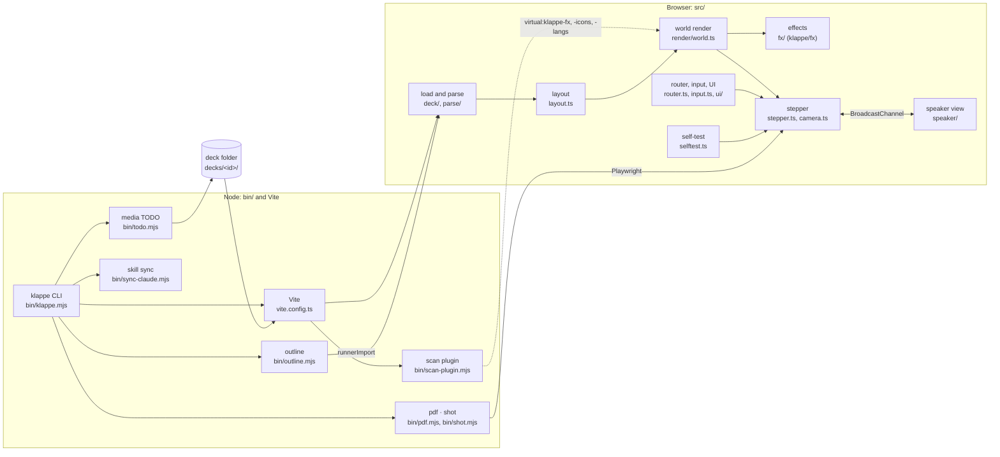
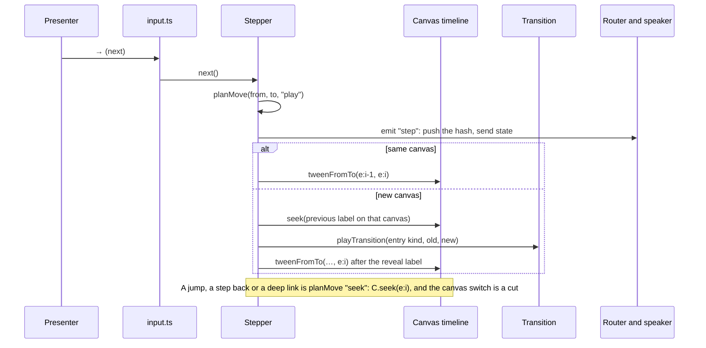

# Architecture

klappe turns a deck folder into one web page. Vite reads the folder at build time; in the browser the engine parses it, lays every section out on a canvas, builds all DOM hidden, writes every step onto one GSAP timeline per canvas, and moves along those timelines as the presenter clicks. Node commands around it build, test, print and inspect a deck. Terms are as in the [glossary](glossary.md); why things are this way is in [DECISIONS.md](../DECISIONS.md).

## Components

| Component | Files | Does |
|---|---|---|
| CLI | `bin/klappe.mjs` | `init`, `dev`, `build`, `test`, `pdf`, `shot`, `outline`. Picks the deck (`--deck`) and hands it to Vite as `KLAPPE_DECK_DIR`. |
| Vite and the scan plugin | `vite.config.ts`, `bin/scan-plugin.mjs` | Serves and bundles klappe with the deck under `@deck`. The plugin scans the deck's code for three virtual modules: the Lucide icons it names, the effects it imports, the code languages it uses, so only those load. |
| Load and parse | `src/deck/load.ts`, `src/deck/assemble.ts`, `src/parse/` | `import.meta.glob` brings in every `.md` as text, every `sections/**/*.ts` as a module, `data/` as text, `media/` as URLs and the themes. `assembleDeck` builds the `Deck`: sections and scenes in folder order, `scene.md` parsed into steps, notes and parts. |
| Layout | `src/layout.ts` | Groups sections into canvases (`shared-canvas`), gives each scene its rect (`place()` or the next 1920x1080 frame), and makes the flat step list (`StepAddr[]`) that every other part indexes. |
| World render | `src/render/world.ts`, `src/render/parts.ts`, `src/render/stage.ts` | Builds each canvas in two passes (below). Runs the default renderer for scenes without `build`, and the backgrounds. |
| Effects | `src/fx/` | Everything `klappe/fx` exports. An effect builds hidden DOM in `build` and returns a handle of step adders. Transitions live here too (`transitions.ts` and one file per heavy one, loaded on demand). |
| Stepper and camera | `src/stepper.ts`, `src/camera.ts` | Moves between steps: queues presses, plays or seeks the canvas timeline, runs a transition when the canvas changes, and starts auto advance. The camera turns a rect into a world pose and a flight. |
| Router, input, UI | `src/router.ts`, `src/input.ts`, `src/ui/`, `src/autoplay.ts` | The URL hash and history, keys, the overview, the selector, the problems panel and autoplay. Every manual jump is a cut. |
| Speaker view | `src/speaker/` | The second window, opened with `?speaker=1`. The main window sends its state; the speaker window sends commands. |
| Self-test | `src/selftest.ts` | Loaded only for `?selftest=walk` or `?selftest=ac`; reports to `window.klappe` for the e2e tests. |
| Theme | `src/theme.ts`, `src/themes/` | Applies the deck's theme tokens (or `?theme=`), loads the bundled fonts, and holds the motion constants. |

## From folder to stage

`src/main.ts` runs these in order:

1. `loadDeck()` returns the `Deck` and its problems. A `?fixture=` loads a test deck from `src/deck/fixtures/` instead.
2. `layoutDeck()` and `buildStepList()` give the canvases and the step list.
3. With `?speaker=1` the page becomes the speaker view and stops here.
4. The parts the deck needs load in parallel: the Markdown parts' effects (chart, terminal, ...) and Shiki grammars, the transitions `section.ts` names, and the text of animated SVG backgrounds. The render after this is synchronous.
5. `renderWorld()` builds every canvas in two passes. **Pass 1** creates all DOM for every scene, hidden: section `build`, scene `build` or the default renderer, backgrounds. Nothing is on a timeline yet, so `seek(0)` is the hidden state. **Pass 2** writes the steps in deck order onto each canvas's paused timeline with `appendStep`: padding, the camera flight to the scene if it moved, the step's tweens, padding, and the label `e:<index>`.
6. A `Stepper` over the step list and canvases, the router, input, panels and the speaker channel are wired up, and the deck goes to the step in the URL with a cut.

## Where the timeline rule is enforced

Seek must equal play. These hold it, from the cheapest to the strongest:

| Where | Checks |
|---|---|
| Skill and [motion](reference/motion.md) | The rule as an author reads it: DOM in `build`, steps only add tweens, `fromTo` with its start set in `build`. |
| `tests/lint/timeline.test.ts` | No `from()` in deck code. A `fromTo` without `immediateRender: false` is not flagged: it is right when its start is the load state, and only the walk can tell. |
| `assembleDeck` | A `scene.ts` with a different number of step functions than `scene.md` has steps is a deck problem. |
| `appendStep` in `world.ts` | A step whose first tween starts before the step (`"<"`, `"-="`) is a deck problem. |
| `?selftest=walk` | Plays every step and jumps to it, also stepping back, and compares the snapshots; a difference fails the walk. |

## Outside the timeline

Some things move on the wall clock, not with the steps: video and aurora backgrounds, animated SVG files, a deck's own loop, `burst`, `mesh3d`, the `crt` screen's decoration, the breathing `glow`, a running `timer`. They sit under `data-k-ignore`, so the snapshot leaves them out; they hold still with reduced motion and in the self-test; and they run only while their canvas is active (`data-k-active`) or their scene is on screen (`ctx.onStep`). An effect that writes the DOM from a tween's progress (`counter`, `crt`, `chat`, `swarm`) marks that element `data-k-text` or `data-k-progress` instead, so the snapshot compares it.

## Node commands

| Command | How |
|---|---|
| `dev`, `build` | Vite with `vite.config.ts`; `build` writes `dist/<id>/` with relative paths. |
| `test` | Vitest's `e2e` project against a Vite server of the deck: the walk, the acceptance checks and the effect tests, in Playwright's Chromium. |
| `pdf`, `shot` | A Vite server on a free port and Playwright: `openDeck` loads the deck with `?instant=1&reducedmotion=1` and no UI; `showStep` cuts to a step and waits for fonts and a painted frame. |
| `outline` | No browser: Vite's `runnerImport` loads `src/deck/assemble.ts`, which parses the deck's Markdown. Scene modules are not loaded. |
| `init` | Writes a starter deck, the scripts in `package.json`, a `tsconfig.json`, and copies the skill and agents (`sync-claude.mjs`). |

## Tests

- `tests/unit/`: pure functions and the parsers, in Node (Vitest `unit` project, with the same aliases and scan plugin as the app).
- `tests/lint/`: static checks over the source, the docs and the decks: design rules, `from()` in deck code, every export documented, the demo using every effect, the skill's catalogue table.
- `tests/e2e/`: Playwright against a Vite server started once in `tests/e2e/setup.ts`, mostly on fixtures (`?fixture=<name>`); `walk.e2e.test.ts` walks the deck itself.
